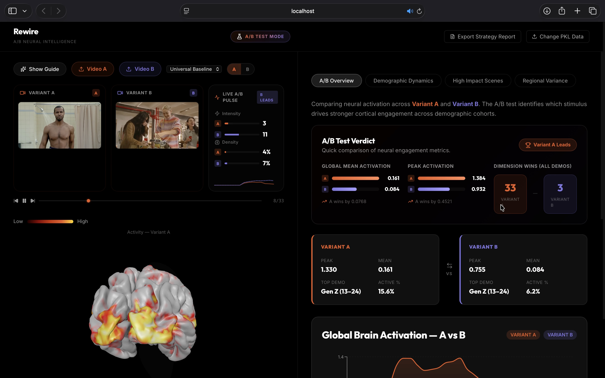
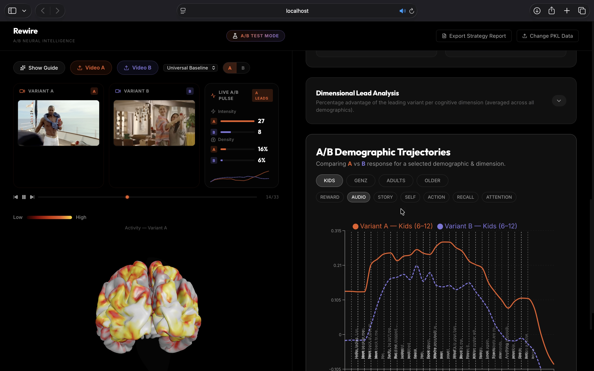
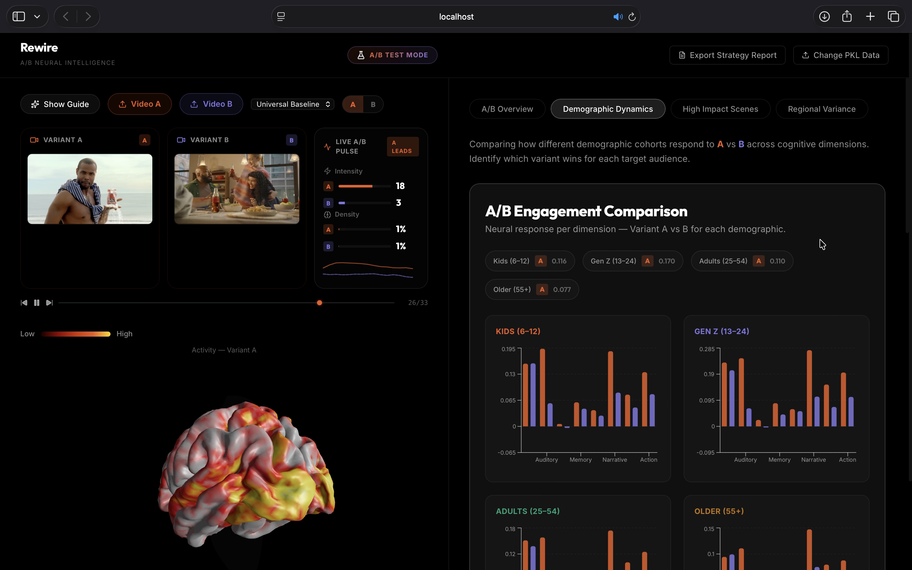
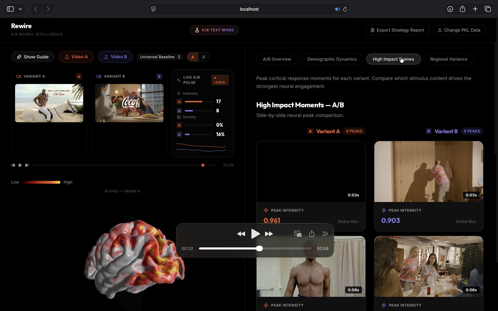

# Rewire: Neural Intelligence & Neuromarketing Analytics 🧠🚀

> **"Subconscious Intelligence. Quantified."**

Rewire is a professional-grade neuromarketing platform that eliminates guesswork in creative A/B testing. By leveraging state-of-the-art deep learning (**Meta's Tribe v2**) and biologically-grounded demographic synthesis, Rewire predicts exactly how human brains respond to video content—before you spend a single rupee on ad placements.

---

## ⚡ High-Level Overview

In an era of attention scarcity, Rewire provides **fMRI-grade insights at the speed of AI.** Traditional focus groups are slow, expensive, and biased by conscious filters. Rewire bypasses these filters to simulate the subconscious response of a **200-brain synthetic ensemble**, providing marketers with a "Neural Twin" of their target audience.

### 🌟 Why Rewire?
*   **Predictive Precision**: Simulate cortical activation across 20,484 vertices with high-dimensional deep learning.
*   **Biological Realism**: Our V3 Engine accounts for temporal latency, neural noise, and demographic-specific firing patterns.
*   **Actionable Intelligence**: Move beyond "engagement scores" to specific cognitive benchmarks like Reward Evaluation, Social Narrative, and Memory Focus.

---

## 📸 Platform Experience

|  |  |
|:---:|:---:|
| **3D Brain Mapping** | **Demographic Trajectories** |

|  |  |
|:---:|:---:|
| **Engagement Analytics** | **High-Impact Timestamps** |

---

## 🏗️ Technical Architecture

Rewire operates on a sophisticated three-stage neural pipeline designed for scale and scientific validity.

### 1. Neural Ingestion (Tribe v2)
Powered by **Meta's Tribe v2** inference engine running on **Nvidia L4 GPUs** (via Modal). It transforms raw video/audio frames into high-resolution Z-scores of predicted cortical activity.

### 2. Analysis Engine V3 (Synthesis)
Our proprietary engine applies biologically-grounded realism to raw predictions:
*   **Temporal Latency**: Staggers peaks to reflect real-world processing speeds (e.g., +3s for Kids, +5s for Older).
*   **Neural Autocorrelation (AR1)**: Mimics the "Pink Noise" of real fMRI BOLD signals for temporal smoothness.
*   **Network Coherence**: Uses Cholesky Decomposition to ensure functional hubs (Reward, Visual, DMN) fire as unified clusters.
*   **Sigmoidal Saturation**: Applies firing caps to prevent unrealistic data spikes, mimicking metabolic limits.

### 3. Intelligence Dashboard
A unified interface built with **React** and **FastAPI** that distills complex neural data into 9 marketing-actionable metrics.

---

## 🛠️ The Tech Stack

### **The Engine Room (Backend)**
- **Language**: Python 3.9+
- **API Framework**: FastAPI
- **Scientific Computing**: NumPy, SciPy, Joblib
- **Inference Pipeline**: Modal (Serverless Cloud GPU)

### **The Command Center (Frontend)**
- **Framework**: React 19 (Vite)
- **3D Visualization**: React Three Fiber / Three.js
- **Data Visualization**: Recharts
- **Styling**: Vanilla CSS (Premium Dark Mode)

---

## 📊 Cognitive Benchmarks

We measure success across 9 key neural dimensions, including:
- **Reward Evaluation**: OFC & Caudate (The "Buy" Signal)
- **Visual Intake**: V1-V3 (Attention & Complexity)
- **Memory Encoding**: Hippocampus & Entorhinal Cortex
- **Social Narrative**: STS (Relatability & Storytelling)
- **Action Readiness**: Premotor Cortex (Intent to Act)

---

## 🚀 Future Roadmap

- [ ] **Real-time Neural Feedback**: Interactive video editing with live engagement updates.
- [ ] **Cross-Cultural Cohorts**: Localized brain synthesis for global market expansion.
- [ ] **Generative Optimization**: AI-driven video re-cutting based on neural peak data.

---

**Rewire** | *Internal Proprietary - Rewire Analytics Engine V3.1*
© 2026 Rewire Analytics. All Rights Reserved.
🚀
