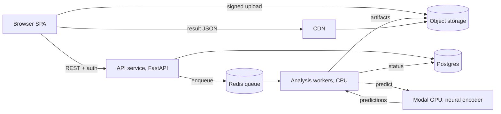

# Rewire as a SaaS: architecture and roadmap

This document describes how Rewire moves from a single-user app on a laptop to a hosted, multi-tenant product. It starts from the code as it stands and names what has to change.

## 1. Where Rewire is today

### Pipeline
1. **Upload.** The browser sends one or two videos to `POST /api/jobs`.
2. **Prediction.** `backend/pipeline.py` sends each video to the neural encoder on a Modal L4 GPU (`modal_inference.py`, class `Predictor`). It returns a `(T, 20484)` array of per-second cortical z-scores plus a transcript of words and sentences.
3. **Audience synthesis and scoring.** `backend/analysis.py` (`run_full_analysis`) expands each prediction into 200 simulated viewers: 4 cohorts of 50, each with latency shifts, haemodynamic blurring, fatigue, correlated noise and saturation. It then averages over 180 regions and scores 8 dimensions plus an overall score.
4. **Serving.** `backend/main.py` keeps the results in memory and serves them to the React dashboard.

### API surface

| Endpoint | Output |
|---|---|
| `POST /api/jobs`, `GET /api/jobs/{id}`, `POST /api/jobs/{id}/cancel` | Job id; stages, per-video progress and status |
| `GET /api/status` | Loaded variants, the current run, any active job |
| `GET /api/overview` | Per variant: `n_timesteps`, `peak_timestep`, per-second metrics (mean, max, left and right, asymmetry, active share) and the transcript |
| `GET /api/ab-summary` | Two variants: winners per cohort and dimension. One variant: a summary of that creative. |
| `GET /api/engagement` | Per variant: scores by cohort and dimension, and the best cohort |
| `GET /api/timeseries` | Per variant: seven network curves per cohort |
| `GET /api/top-rois` | Per variant: the top 5 regions and their time series |
| `GET /api/heatmap` | Per variant: viewer-to-viewer variance for the 30 most variable regions, per cohort |
| `GET /api/brain-mesh` | The fsaverage5 surface (20,484 vertices), the same for every analysis |
| `GET /api/brain-activation/{t}` | 20,484 values for one second, variant and cohort |
| `GET /api/ensemble`, `POST /api/ensemble/activation` | The 200 viewer profiles, and a group's mean regional map |
| `POST /api/upload-predictions`, `POST /api/load-sample-data` | Imports saved predictions, or loads the sample pair |

### What blocks multi-tenancy
- **Global state.** `_results` in `main.py` holds one analysis for the whole process, so two users would overwrite each other.
- **Memory.** `run_full_analysis` builds four float32 ensembles of 50 viewers by T seconds by 20,484 vertices, about 135 MB per cohort for a 33-second video, and keeps all four until scoring (peak about 1.2 GB for one variant). Memory grows linearly with video length and viewer count.
- **Per-cohort mean brains kept as Python lists** (`demo_mean_brains`), which is slow to build and heavy to hold. Brain activation is served from these lists.
- **Per-viewer profiles** (`build_profiles`) are compact (about 5 MB per variant) but also live only in memory.
- **In-process jobs.** One job at a time, held in a thread, and lost on restart.
- **No identity.** There are no users, organisations, auth or quotas.

## 2. Target architecture

- **Frontend.** The existing React app, built to static files and served from a CDN such as Vercel, Cloudflare Pages or S3 with CloudFront.
- **API.** Stateless FastAPI, with no analysis held in memory. Every request is scoped to an organisation and an analysis id. It runs as several instances behind a load balancer, on Fly, Render or Cloud Run.
- **Postgres** for durable records:
  - `orgs (id, name, plan, stripe_customer_id, created_at)`
  - `users (id, email, name, created_at)` and `memberships (org_id, user_id, role)`
  - `projects (id, org_id, name)`
  - `analyses (id, project_id, mode, status, variant_names, metadata, artifact_prefix, created_by, created_at, finished_at)`
  - `jobs (id, analysis_id, stage, progress jsonb, error, attempts, started_at, finished_at)`
  - `usage_events (id, org_id, analysis_id, kind, video_seconds, gpu_seconds, created_at)`
  - `api_keys (id, org_id, hashed_key, scopes, created_at, revoked_at)`
- **Object storage** (S3 or R2):
  - **Uploads:** the browser uploads videos directly with presigned URLs, so they never pass through the API.
  - **Predictions:** stored as `.npy` or `.pkl`.
  - **Artifacts:** stored as JSON.
  - **Lifecycle rules:** they delete uploaded videos after the retention window.
- **Queue and workers.** Redis, with RQ, Celery or Arq. CPU workers run the synthesis and scoring and generate artifacts. Video ingestion and GPU calls are separate steps, so a GPU failure can be retried without redoing the rest.
- **GPU inference.** Stays on Modal: the deployed `Predictor` class with a persistent weight cache, warm containers and per-plan concurrency limits. The worker calls it and streams stage events into the `jobs` table. A Modal webhook can replace streaming once jobs are long.
- **Results as artifacts.** Each finished analysis writes one JSON file per endpoint (overview, engagement, timeseries, top-rois, heatmap, summary, ensemble) under `artifacts/<analysis id>/`. The dashboard reads them through the CDN, so serving a result costs almost nothing.
- **Brain activation on demand.** Each cohort's per-second mean is stored as a float16 `.npy`, 20,484 by T, about 1.3 MB per cohort for 33 seconds. The API slices one second at a time, or the client fetches the whole array once and slices locally.

## 3. Backend refactors needed
1. **Key everything by analysis id.** Replace `_results` with a store interface (`load_artifact(analysis_id, name)`) backed by storage, and remove module-level state.
2. **Stream cohorts.** Generate one cohort ensemble at a time (already float32), reduce it to region and mean summaries, and drop it before the next. Peak memory falls to a few hundred MB per variant, independent of other users.
3. **Store arrays, not lists.** Keep `demo_mean_brains` as `np.float16`, never as Python lists.
4. **Write artifacts.** Add an `export_artifacts(cache) -> dict[name, json]` step at the end of `run_full_analysis`, and serve those files instead of computing per request.
5. **Make jobs durable.** Move `JobManager` stages into Postgres so progress survives restarts and can be read by any API instance.
6. **Keep the engine interface.** `ModalEngine` stays. A dedicated-GPU engine on RunPod, Lambda or the organisation's own cluster can be added for enterprise without touching the pipeline.
7. **Validate ingest.** Use `ffprobe` checks for duration, size and codec, and normalise to H.264 MP4 at a fixed resolution before inference, so the encoder sees consistent input.

## 4. Product layer
- **Authentication.** Clerk or Supabase Auth, with email, Google and SSO (SAML) for enterprise plans. The API verifies JWTs and resolves the organisation on every request.
- **Organisations and roles.** Owner, admin, analyst and viewer. Shared analyses are read-only links with expiry.
- **Billing.** Stripe:
  - Plans by monthly video minutes analysed, with seats included.
  - Overage metered from `usage_events.video_seconds`.
  - Enterprise contracts invoiced.
- **Quotas.** Checked before a job is queued: minutes remaining, maximum video length, and concurrent jobs per plan.
- **Privacy and retention.**
  - Uploaded videos are deleted after processing by default, or kept for 30 days on request.
  - Predictions and artifacts are kept for the life of the project.
  - Per-region data residency (EU or US buckets) for enterprise.
  - A DPA template.
  - Results stay predictions for simulated viewers, never claims about real people.
- **Model confidentiality.** The neural encoder is never named in the UI, API responses, artifacts or error messages. Errors from the GPU service are mapped to neutral messages before they reach clients. Weights live only in the private Modal volume.
- **Public API.** Organisation API keys with scopes, the same job endpoints, and webhooks on completion, for agencies that want to automate testing.

## 5. Operations
- **Observability.**
  - Sentry on the frontend, API and workers.
  - Structured logs with analysis and job ids.
  - Metrics for queue depth, time per stage, GPU cold-start rate, failure rate by stage, and cost per analysis.
- **GPU cost model.**
  - An L4 on Modal costs roughly $0.80 an hour (check current pricing).
  - Assume about 4 minutes of GPU time for a 30-second video once warm, plus 2 to 4 minutes for a cold start.
  - That puts GPU cost at roughly $0.05 to $0.10 per 30-second video warm, and up to about $0.15 cold.
  - CPU synthesis is about 1 minute per variant on a 2 vCPU worker.
  - Price plans per minute of video with at least a 5x margin over this.
- **Concurrency and cold starts.**
  - Modal autoscaling with a per-organisation concurrency cap.
  - A small pool of warm containers in working hours for paid plans.
  - The weight volume keeps cold starts to model loading, not downloading.
- **Security.**
  - Presigned uploads with content-type and size limits.
  - A virus and format check on ingest.
  - Least-privilege IAM for workers.
  - Secrets in the platform's secret store.
  - Tenant isolation enforced in every query, with row-level security in Postgres.
- **Reliability.**
  - Idempotent job steps with retries and backoff.
  - A dead-letter queue.
  - Partial results kept per stage, so a failed scoring step does not repeat a GPU run.

## 6. Roadmap

| Phase | Scope | Exit criteria |
|---|---|---|
| **0. Local app, cloud GPU (now)** | Drag-and-drop for one or two videos, a pipeline progress screen, Modal inference, runs saved locally, the full dashboard | A 30-second video goes from upload to dashboard on a laptop with no manual steps |
| **1. Hosted beta** | The single-tenant hosted API and SPA, object storage, a Postgres job table, artifact serving, invite-only auth, the streaming-cohort refactor | 10 design partners run real campaigns; p95 time to results under 10 minutes; no lost jobs across deploys |
| **2. Multi-tenant with billing** | Organisations and roles, Stripe plans and metering, quotas, retention controls, share links, the public API with webhooks | Self-serve sign-up to paid in one session; cost per analysis tracked; tenant isolation tested |
| **3. Scale and enterprise** | SSO, data residency, dedicated GPU capacity, audit logs, SLAs, batch testing of many creatives, team workspaces | First enterprise contracts; 99.9% API availability; regional deployments |
